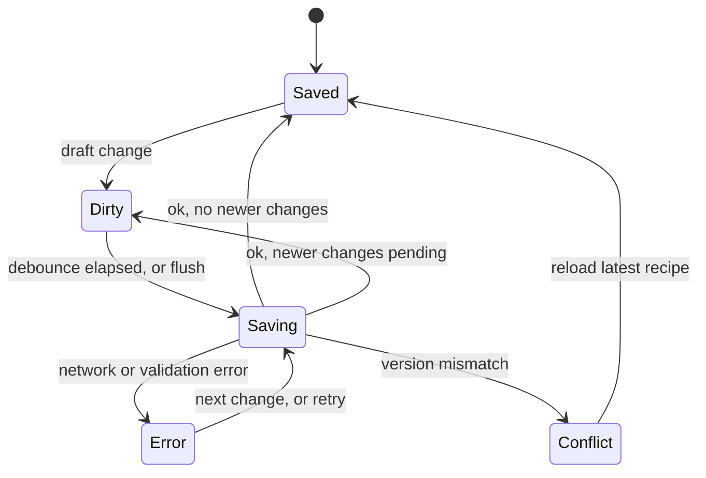
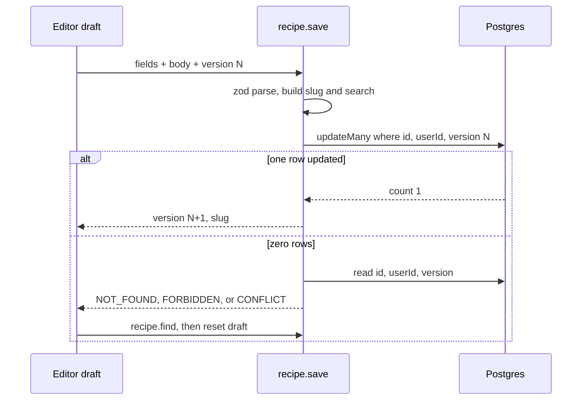

# Flatten Recipe Model - Plan

## Goal Capsule

- **Objective:** A recipe author edits a recipe and every change persists as one consistent recipe. Authors never see "Waiting for server..." errors, half-saved recipes, or lost edits, and existing recipes look the same after the change.
- **Means:** Store ingredient groups and steps as one zod-validated JSONB `body` on `recipe`, saved through a single version-checked `recipe.save` from a client-side draft (KTD1, KTD2, KTD4).
- **Authority:** Product Contract Requirements win on behavior. KTDs win on mechanism. Units follow both.
- **Stop conditions:** Stop and ask if the backfill cannot reproduce an existing recipe exactly, or if a requirement cannot be met without keeping the child tables.
- **Execution profile:** Units U1 to U6 land in order on one branch. U3 changes the shape `findRecipe` returns, so the app type-checks again only after U6. Apply the type-check gate at the end of U6, not per unit in U3 to U5. U7 (drop child tables) lands only after the verification script passes against real data.
- **Out of scope here:** Postgres full-text search. Its outline is in the Appendix.

---

## Product Contract

### Summary

Replace the `IngredientGroup`, `Ingredient`, `Step`, and `Instruction` tables with a JSONB `body` column on `recipe`. Replace the twelve child tRPC mutations with one `recipe.save`. The editor edits a local draft and autosaves it. Existing data moves into `body`, and the current Fuse.js search keeps working through a bridge.

### Problem Frame

The recipe is one document with one author, but it is stored as four child tables with their own tRPC routers. Each field edit is a separate mutation with its own ownership lookup. The client cache in `app/hooks/recipe-cache.ts` repeats optimistic insert, temp-id swap, and rollback logic for each model. New rows have no server id until their create call returns, so edits made in that window fail with "Waiting for server...". Several in-flight mutations can partly fail, so a recipe can end up half-saved. Nothing outside a recipe references its children: pins and bookmarks reference the recipe, and the only cross-cutting use of child data is ingredient names in the denormalized `search` column.

### Requirements

**Data model**
- R1. A recipe stores its ingredient groups, ingredients, steps, and instructions as one `body` value validated by a shared zod schema.
- R2. Every group, ingredient, step, and instruction has a stable string id created on the client. Array order is display order.
- R3. All existing recipes migrate into `body` with identical content and order.

**Saving**
- R4. One save call persists all editable recipe fields and the body together, or persists nothing.
- R5. A save based on a stale version is rejected. The editor then reloads the latest recipe and tells the author that their unsaved changes in this tab were discarded.
- R6. Only the recipe owner can save. Invalid input is rejected with a field-level message.

**Editing**
- R7. Edits commit to a local draft immediately. New items are editable at once, with no wait for the server.
- R8. The draft autosaves shortly after each committed change. The author sees saving, saved, and error states.
- R9. Edits that are not yet saved are flushed when the author leaves the editor. Closing the tab with unsaved changes prompts the browser warning.

**Compatibility**
- R10. The public recipe view, pins, bookmarks, ingredient scaling, and step navigation behave as before.
- R11. The recipe lists and Fuse.js filtering keep working. Ingredient names stay searchable.

### Key Decisions

- **JSONB body instead of child tables.** Governs R1, R2, R3. (session-settled: user-approved — chosen over keeping the child tables behind a single transactional save: the children are never queried on their own, and a document column removes id churn and index bookkeeping.)
- **Flattening ships before full-text search.** Search work is deferred to a separate change. (session-settled: user-approved — chosen over one combined change: the frontend surfaces barely overlap, and the generated search column depends on the new body shape.)
- **Debounced autosave instead of a Save button.** Governs R8. Typing feels the same as today. (session-settled: user-approved — chosen over an explicit Save button.)
- **Stale saves are rejected.** Governs R5. (session-settled: user-approved — chosen over last-write-wins: two tabs must not silently overwrite each other.)

### Scope Boundaries

- No change to recipe create, delete, pins, bookmarks, or auth.
- No drag-and-drop reordering UI. The array model makes it easy later.
- No real-time collaboration or merge of concurrent edits.
- No component tests for the editor. Coverage targets the schema, draft operations, save procedure, and migration.

#### Deferred to Follow-Up Work

- Postgres full-text search, server-side pagination, and removal of Fuse.js and the `search` column. Outline in the Appendix.
- Item reordering controls in the editor.

---

## Planning Contract

### Key Technical Decisions

- KTD1. **`body` is a `Json` column parsed by zod at the service boundary.** `findRecipe` parses `body` with the shared schema, so every consumer gets typed data. No new Prisma generator dependency. A parse failure is a server error, because stored data always passed the same schema on write.
- KTD2. **`recipe.save` is one version-checked `updateMany`.** The write filters on `id`, `userId`, and `version`, and increments `version`. When zero rows match, one follow-up read decides the error: missing recipe gives NOT_FOUND, another owner gives FORBIDDEN, and a version mismatch gives CONFLICT. This folds the ownership check into the write. Governs R4, R5, R6.
- KTD3. **Save sends all editable fields.** Payload: `id`, `version`, `name`, `tags`, `published`, `prepTime`, `cookTime`, `serves`, `intro`, `body`. The server recomputes `slug` and `search`. `recipe.update` is removed. A name that collides with another of the author's slugs gives BAD_REQUEST with a name-specific message.
- KTD4. **The draft lives in React state scoped to the edit page.** A provider holds the draft, the last saved version, and the save status. Pure draft operations (add, update, remove an item) live in a separate module so they are unit-testable. Jotai is not used here, because the draft is per-page and per-recipe, not global.
- KTD5. **Field editors keep the `useEditor` contract.** `onSave(value, options)` validates the field with zod, writes it into the draft, and calls `onSuccess` at once. Validation errors still show inline. Server errors show in the save status, not on the field.
- KTD6. **Autosave is commit-driven with a short debounce.** `useEditor` commits on blur or Enter, so the draft changes in discrete steps. A debounce of about 500 ms batches structural edits. Only one save is in flight. Changes made during a save trigger one more save with the new version.
- KTD7. **Ids are `crypto.randomUUID()` strings.** The backfill uses `gen_random_uuid()`. The view's `parsedAmountsAtom` becomes keyed by string id.
- KTD8. **List queries omit `body`.** `findRecipes` and `findBookmarkedRecipes` use Prisma `omit`, so list pages do not ship recipe bodies to the client.
- KTD9. **Child tables are dropped in a separate, later migration.** The backfill migration leaves them in place. A verification script compares every recipe's `body` with its child rows. U7 runs only after the script passes on production data.
- KTD10. **The `search` bridge is a pure function.** `buildSearchText(recipe, user)` derives the search string from name, author name and handle, tags, and ingredient names in `body`. `recipe.save` writes it in the same update. `updateRecipeSearch` is deleted.

### High-Level Technical Design

Save lifecycle on the client:



Save round trip and conflict path:



Body shape (directional, not a spec):

```text
body
  ingredientGroups[]: { id, name, ingredients[]: { id, amount, units, name, preparation } }
  steps[]:            { id, name, intro, instructions[]: { id, text } }
```

### Risks & Dependencies

| Risk | Mitigation |
|---|---|
| Backfill loses or reorders content | Order by `index`, then `id`. The verification script runs before U7. U7 is a separate deploy. |
| Duplicate `index` values in old data | The tie-break on `id` keeps order deterministic. |
| Unsaved edits lost on navigation | Flush on unmount, plus a `beforeunload` prompt while dirty or saving (R9). |
| Large or abusive payloads | Zod caps array lengths and string lengths in the body schema. |
| `body` drifts from the schema | All writes go through `recipe.save`, which parses with the same schema used on read (KTD1). |

### Deferred to Implementation

- Exact zod caps for array and string lengths.
- Whether the save-status indicator sits in the header or floats.
- Whether the integration test uses a separate database or a throwaway user in the dev database.

---

## Implementation Units

### U1. Shared body schema

- **Goal:** Define the zod schema and types for the recipe body and the save payload.
- **Requirements:** R1, R2, R6
- **Dependencies:** none
- **Files:**
  - Create `app/schema/recipe-body.ts`
  - Modify `app/schema/recipe.ts` (add the `Save` payload schema, reusing `Name` and the `serves` rule)
  - Modify `app/schema/index.ts`
  - Create `app/schema/recipe-body.test.ts`
- **Approach:**
  1. Define the ingredient, group, instruction, step, and body schemas. Reuse `AMOUNT_REGEX` for `amount`.
  2. Export inferred types. They replace `IngredientData`, `StepData`, and the other types derived from the Prisma include.
  3. Export an `emptyBody` constant for new recipes and the column default.
- **Patterns to follow:** `app/schema/ingredient.ts`, `app/schema/recipe.ts` (namespace export style through `app/schema/index.ts`).
- **Test scenarios:**
  - A body with two groups, three steps, and nested items parses and keeps order.
  - An empty body (`{ ingredientGroups: [], steps: [] }`) parses.
  - An ingredient `amount` that fails `AMOUNT_REGEX` is rejected with "Invalid format".
  - An item without `id`, or with an empty `id`, is rejected.
  - Arrays and strings over the caps are rejected.
  - A save payload with an invalid `name` is rejected with the `Name` message.
- **Verification:** The schema tests pass. Types are importable from `@schema`.

### U2. Migration: add body and backfill

- **Goal:** Add `body`, `version`, and `updatedAt` to `recipe` and fill `body` from the child tables.
- **Requirements:** R3
- **Dependencies:** U1
- **Files:**
  - Modify `prisma/schema.prisma` (add `body Json`, `version Int @default(0)`, `updatedAt DateTime @updatedAt`; keep the child models for now)
  - Create `prisma/migrations/<timestamp>_recipe_body/migration.sql`
  - Create `prisma/scripts/verify-recipe-body.ts`
- **Approach:**
  1. Generate the migration with `bunx --bun prisma migrate dev --create-only`, then add the backfill SQL by hand.
  2. Build `body` with nested `jsonb_agg` ordered by `index`, then `id`. Give every item a `gen_random_uuid()` id.
  3. Set the column default to the empty body for new recipes. Give `updatedAt` a default of `now()` for existing rows.
  4. The verification script loads each recipe with its child rows and its `body`, and compares them field by field and in order. It prints mismatches and exits non-zero on any mismatch.
  5. Run `bunx --bun prisma generate`.
- **Patterns to follow:** `prisma/migrations/20260523185629_recipe_serves_to_string/migration.sql` (hand-edited SQL in a Prisma migration).
- **Test scenarios:**
  - On a dev database seeded with recipes that have multiple groups and steps, the verification script reports zero mismatches.
  - A recipe with no groups or steps gets the empty body.
  - Two ingredients with the same `index` keep `id` order.
  - Editing one `body` by hand makes the script report that recipe and exit non-zero.
- **Verification:** The migration applies cleanly on a copy of real data, and the verification script passes.

### U3. Server: read path and recipe.save

- **Goal:** Serve `body` through the services and replace per-field updates with `recipe.save`.
- **Requirements:** R4, R5, R6, R11
- **Dependencies:** U1, U2
- **Files:**
  - Modify `app/services/recipe.ts` (`findRecipe` selects and parses `body`, list queries omit it, add `buildSearchText`, add `saveRecipe`, delete `updateRecipeSearch`)
  - Modify `app/trpc/routers/recipe.ts` (add `save`, remove `update`, `create` sets the empty body)
  - Create `app/services/recipe.test.ts`
- **Approach:**
  1. `findRecipe` drops the child includes, selects `body` and `version`, and returns parsed data (KTD1).
  2. `findRecipes` and `findBookmarkedRecipes` omit `body` (KTD8).
  3. `saveRecipe(userId, input)` follows KTD2 and KTD3, and writes `search` from `buildSearchText` (KTD10). It reads the author's name and handle from `user` for the search text. It returns the new `version` and `slug`.
  4. Map a Prisma unique violation on `(userId, slug)` to BAD_REQUEST with a name message.
  5. Move `toSlug` into the service so the router stays thin.
- **Patterns to follow:** `authedProcedure` and the `TRPCError` codes in `app/trpc/routers/recipe.ts`.
- **Test scenarios:**
  - `buildSearchText` includes the recipe name, author name and handle, tags, and every ingredient name, lowercased.
  - `buildSearchText` with an empty body returns only the name, author, and tags.
  - Integration: saving with the current version updates every field and `body`, increments `version`, and recomputes `slug` and `search`.
  - Integration: saving with an old version returns CONFLICT and changes nothing.
  - Integration: saving another user's recipe returns FORBIDDEN and changes nothing.
  - Integration: saving a missing id returns NOT_FOUND.
  - Integration: renaming to a name whose slug the author already uses returns BAD_REQUEST and changes nothing.
  - Integration: an invalid body is rejected before any write.
  - `findRecipes` results contain no `body` field.
- **Verification:** Service and integration tests pass. The tRPC router exposes `find`, `create`, `save`, and `delete` for recipes.

### U4. Client draft and autosave

- **Goal:** Provide the edit page with a draft, pure draft operations, and an autosave loop.
- **Requirements:** R5, R7, R8, R9
- **Dependencies:** U1, U3
- **Files:**
  - Create `app/lib/recipe-draft.ts` (pure operations on the draft)
  - Create `app/hooks/recipe-draft.tsx` (provider, `useRecipeDraft`, autosave, field updaters)
  - Create `app/components/recipe/editor/save-status.tsx`
  - Create `app/lib/recipe-draft.test.ts`
  - Modify `app/hooks/index.ts`
- **Approach:**
  1. Pure operations: set a recipe field, add, update, and remove a group, ingredient, step, or instruction by id. Each returns a new draft. New items get `crypto.randomUUID()` ids (KTD7).
  2. The provider holds the draft, the last saved version, and the status. It runs the KTD6 save loop and the lifecycle in the High-Level Technical Design.
  3. Field updaters keep the `ProcedureOptions` contract (KTD5): validate the field with zod, apply the operation, call `onSuccess`, or call `onError` with the zod message.
  4. On CONFLICT, call `recipe.find`, reset the draft and version, and show the R5 message.
  5. In the error state, the save status offers a retry control, so a failed save does not wait for the next edit.
  6. Flush on unmount, and register `beforeunload` while the status is dirty, saving, or error (R9).
- **Patterns to follow:** `makeFieldUpdater` in `app/hooks/recipe-cache.ts` (field validation shape), `RecipeIdContext` (context plus a guard hook).
- **Test scenarios:**
  - Adding an ingredient to a group appends it with a new unique id and empty fields.
  - Updating an ingredient field changes only that ingredient.
  - Removing a step removes it and its instructions and leaves the other steps unchanged.
  - Operations on an unknown id return the draft unchanged.
  - Operations do not mutate the input draft.
  - A field update with an invalid `amount` calls `onError` and leaves the draft unchanged.
- **Verification:** Pure operation tests pass. In the running app, a new ingredient is editable at once, and the status moves from saving to saved.

### U5. Rewire the editor and remove the child API

- **Goal:** Move editor components to the draft and delete the per-model API.
- **Requirements:** R7, R8
- **Dependencies:** U4
- **Files:**
  - Modify `app/routes/edit.$id.tsx` (seed the draft provider from the loader, drop `useQuery`)
  - Modify `app/components/recipe/editor/recipe-editor.tsx`, `ingredient-group-editor.tsx`, `ingredient-editor.tsx`, `step-editor.tsx`, `instruction-editor.tsx`, `tags-editor.tsx`
  - Modify `app/trpc/router.ts`
  - Delete `app/hooks/recipe-cache.ts`
  - Delete `app/trpc/routers/step.ts`, `instruction.ts`, `ingredientGroup.ts`, `ingredient.ts`
  - Delete `app/schema/step.ts`, `instruction.ts`, `ingredientGroup.ts`, `ingredient.ts`, and update `app/schema/index.ts`
  - Modify `app/lib/utils.ts` (remove `getNextIndex`)
- **Approach:**
  1. Components read items from the draft and call the U4 updaters. Keys use item `id`.
  2. The publish toggle and the tags editor become draft updates. The tags editor keeps its duplicate and empty checks and its refocus after adding.
  3. Keep the existing focus-the-new-item behavior after adding a group, ingredient, step, or instruction.
  4. Render the save status in the editor header.
- **Patterns to follow:** existing editor components. Keep markup and class names unchanged so styles still apply.
- **Test expectation:** none in unit tests (editor component tests are out of scope). Covered by the manual checks below.
- **Verification:** After U6, the type check passes with the child routers deleted. Manual run: add, edit, and delete every item type, toggle publish, add and remove tags, and reload the page. All changes persist. A second tab saving first produces the conflict message and reload.

### U6. Rewire the public view

- **Goal:** Render the public recipe from the parsed body.
- **Requirements:** R10
- **Dependencies:** U3
- **Files:**
  - Modify `app/components/recipe/view/recipe.tsx`, `ingredient-group.tsx`, `step.tsx`, `step-bar.tsx`
  - Modify `app/atoms/amount.ts` (key `parsedAmountsAtom` by string id)
  - Modify `app/hooks/scroll-navigation.ts` (use the body step type)
  - Modify `app/routes/recipes.$handle.$slug.tsx` if its types need updating
- **Approach:** Swap the Prisma-derived types for the U1 types. Keys and amount lookups use string ids. Step navigation still uses positional `step_N` element ids, so it needs no logic change.
- **Patterns to follow:** current view components.
- **Test expectation:** none -- type change only. Behavior is checked manually.
- **Verification:** A migrated recipe renders the same as before the migration. Scaling changes ingredient amounts and serves. The step bar tracks and scrolls to steps. Pin and bookmark still toggle.

### U7. Drop the child tables

- **Goal:** Remove the old tables after the data is verified.
- **Requirements:** R3
- **Dependencies:** U2 to U6 deployed, and `prisma/scripts/verify-recipe-body.ts` passing on production data
- **Files:**
  - Modify `prisma/schema.prisma` (remove the four child models and their relations on `Recipe`)
  - Create `prisma/migrations/<timestamp>_drop_recipe_children/migration.sql`
  - Delete `prisma/scripts/verify-recipe-body.ts`
- **Approach:** Generate the drop migration with `bunx --bun prisma migrate dev`, then run `bunx --bun prisma generate`. Take a database backup before applying it in production.
- **Test expectation:** none -- schema removal. The type check proves that no code references the dropped models.
- **Verification:** The migration applies. The type check and full test suite pass. The app runs.

---

## Verification Contract

| Gate | Command or check | Applies to |
|---|---|---|
| Unit tests | `bun test` | U1, U3, U4 |
| Type check | `bunx react-router typegen && bunx tsc --noEmit` | All units |
| Lint | `bunx biome check app` | All units |
| Migration | `bunx --bun prisma migrate dev` on a copy of real data | U2, U7 |
| Data check | `bun prisma/scripts/verify-recipe-body.ts` reports zero mismatches | U2, before U7 |
| Manual | The editor and view checks listed in U5 and U6 | U5, U6 |

## Definition of Done

- R1 to R11 hold, checked by the gates above.
- No code references `IngredientGroup`, `Ingredient`, `Step`, `Instruction`, `recipe-cache`, `getNextIndex`, or `updateRecipeSearch`.
- The tRPC router exposes only `recipe`, `pin`, and `bookmark`.
- List payloads contain no `body`.
- Abandoned or experimental code from dead-end attempts is removed from the diff.
- U7 is applied only after the data check passes on production data.

---

## Appendix

### Follow-up: Postgres full-text search (outline)

This outline gets a full plan after U1 to U6 land. It assumes the `body` shape above.

- **Goal:** Search runs in Postgres with ranking and pagination, so list pages stop shipping every recipe to the client.
- **Index:**
  - Add a generated `tsvector` column with weights: name (A), tags (B), ingredient names from `body` (C).
  - Generated columns need immutable expressions. Add small `IMMUTABLE` SQL wrapper functions for the tags and ingredient-name text if needed.
  - Add a GIN index on the column.
  - Optionally add `pg_trgm` with a trigram index on `name` for typo tolerance.
- **Query:**
  - Run it with Kysely, which is already a dependency, because Prisma sees the column only as `Unsupported("tsvector")`.
  - Add a prefix match to the last term, so search-as-you-type matches partial words.
  - Rank with `ts_rank`. Author handle and name match through a join, because a generated column cannot read `user`.
- **Routes:**
  - The `_index` and `my-recipes` loaders read `?q=` and `?page=` and return one page plus a total count.
  - The input updates the URL params with a debounce of about 250 ms and `replace: true`.
  - Pending state comes from `useNavigation`.
- **Removal:** Delete Fuse.js, the `search` column, and `buildSearchText` in the same change.
- **Open questions for that plan:** whether to add trigram matching, whether author search is needed on public lists, and the page size.
